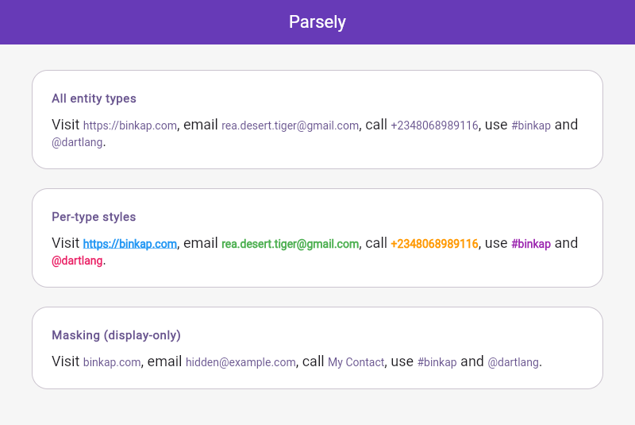
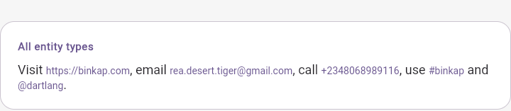
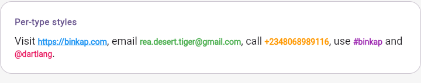

# Parsely

[](https://pub.dev/packages/binkap_parsely)
[](LICENSE)
[](https://github.com/binkapS/binkap_parsely/actions)

**Parsely** turns plain text into tappable rich text. It extracts links, emails, phone numbers, hashtags, and @mentions from a `String` and renders them as tappable spans with customizable styling, masking, and display transforms — with zero runtime dependencies.

> Masking is **display-only**: the parsed value is preserved. See [Privacy & masking](#privacy--masking) for details.

## Table of contents

- [Getting started](#getting-started)
- [Full example](#full-example)
- [Screenshots](#screenshots)
- [API reference](#api-reference)
  - [Parsely](#parsely)
  - [ParselyOptions](#parselyoptions)
  - [ParselyMasks / ParselyMaskBuilder](#parselyMasks--parselyMaskBuilder)
  - [ParselyElement](#parselyElement)
  - [ParselyType](#parselyType)
  - [ParselyParser](#parselyParser)
  - [SelectableParsely](#selectableParsely)
  - [ParselyLaunch](#parselyLaunch)
- [Usage matrix: I want to...](#usage-matrix-i-want-to)
- [Privacy & masking](#privacy--masking)
- [Troubleshooting / FAQ](#troubleshooting--faq)
- [Migration guide](#migration-guide)
- [Out of scope](#out-of-scope)
- [License](#license)
- [Contributing](#contributing)

## Getting started

Add `binkap_parsely` to your `pubspec.yaml`:

```yaml
dependencies:
  binkap_parsely: ^1.0.0
```

Or run:

```bash
flutter pub add binkap_parsely
```

Then use it:

```dart
import 'package:binkap_parsely/binkap_parsely.dart';
import 'package:flutter/material.dart';

// Inside a widget's build method:
return Parsely(
  text: 'Hello @dartlang, visit https://dart.dev!',
  onTap: (element) {
    debugPrint('Tapped ${element.type.name}: ${element.parsed}');
  },
);
```

### Minimal snippet

```dart
Parsely(
  text: 'Mail me at a@b.com or call +2348068989116 #flutter',
  onTap: (element) => print(element.parsed),
)
```

## Full example

This example compiles verbatim against the current API:

```dart
import 'package:binkap_parsely/binkap_parsely.dart';
import 'package:flutter/material.dart';

void main() => runApp(const ParselyDemoApp());

class ParselyDemoApp extends StatelessWidget {
  const ParselyDemoApp({super.key});

  @override
  Widget build(BuildContext context) {
    return MaterialApp(
      home: Scaffold(
        body: Center(
          child: Parsely(
            text:
                'Visit https://binkap.com, email rea.desert.tiger@gmail.com, '
                'call +2348068989116, or use #binkap and @dartlang.',
            textAlign: TextAlign.center,
            style: const TextStyle(color: Colors.black, fontSize: 16),
            parsedStyle: const TextStyle(
              color: Colors.blue,
              fontSize: 16,
              decoration: TextDecoration.underline,
            ),
            options: const ParselyOptions(
              parseHashtag: true,
              parseMention: true,
              parsePhone: true,
              parseEmail: true,
              parseLink: true,
              stripLinkScheme: true,
            ),
            masks: const ParselyMasks(
              exact: {'+2348068989116': 'My Contact'},
            ),
            onTap: (element) {
              switch (element.type) {
                case ParselyType.link:
                  debugPrint('Clicked link: ${element.parsed}');
                  break;
                case ParselyType.email:
                  debugPrint('Clicked email: ${element.parsed}');
                  break;
                case ParselyType.phone:
                  debugPrint('Clicked phone: ${element.parsed}');
                  break;
                case ParselyType.hashTag:
                  debugPrint('Clicked hashtag: ${element.parsed}');
                  break;
                case ParselyType.mentionTag:
                  debugPrint('Clicked mention: ${element.parsed}');
                  break;
              }
            },
          ),
        ),
      ),
    );
  }
}
```

## Screenshots

Rendered from the live `example/` app on the web (real fonts, not test-font outlines):








Pixel-regression goldens live in `test/goldens/` (`test/goldens_test.dart`) and cover light, dark, RTL and masking states.

## API reference

### Parsely

The main widget. Renders `text` with tappable entity spans.

| Parameter | Type | Description | Default |
|---|---|---|---|
| `text` | `String` | Source text to parse (required). | — |
| `style` | `TextStyle?` | Style for non-entity text. | `null` |
| `parsedStyle` | `TextStyle?` | Style for entity spans. | `null` (theme primary) |
| `parsedStyles` | `Map<ParselyType, TextStyle>?` | Per-type entity styles; wins over `parsedStyle`. | `null` |
| `maxLines` | `int?` | Max lines. | `null` |
| `textAlign` | `TextAlign` | Alignment. | `TextAlign.start` |
| `textDirection` | `TextDirection?` | Text direction. | `null` |
| `softWrap` | `bool` | Whether to soft-wrap. | `true` |
| `overflow` | `TextOverflow` | Overflow behavior. | `TextOverflow.clip` |
| `textScaler` | `TextScaler?` | Text scaler. | `null` (from `MediaQuery`) |
| `locale` | `Locale?` | Locale. | `null` |
| `strutStyle` | `StrutStyle?` | Strut style. | `null` |
| `textWidthBasis` | `TextWidthBasis` | Text width basis. | `TextWidthBasis.parent` |
| `textHeightBehavior` | `TextHeightBehavior?` | Text height behavior. | `null` |
| `selectionRegistrar` | `SelectionRegistrar?` | Selection registrar. | `null` |
| `selectionColor` | `Color?` | Selection color. | `null` |
| `options` | `ParselyOptions?` | Parsing/display options. | `null` (all enabled) |
| `enabledEntities` | `Set<ParselyType>?` | Canonical entity-type override; wins over `options`. | `null` |
| `onTap` | `ValueChanged<ParselyElement>?` | Called when any entity is tapped. | `null` |
| `onTapHandlers` | `Map<ParselyType, ValueChanged<ParselyElement>>?` | Per-type tap handlers (called before `onTap`). | `null` |
| `masks` | `ParselyMasks?` | Map-based masking config (preferred). | `null` |
| `maskBuilder` | `ParselyMaskBuilder?` | Function-based masking. Takes precedence over `masks`. | `null` |
| `customRules` | `List<EntityRule>` | Custom entity rules. | `[]` |

### ParselyOptions

| Parameter | Type | Description | Default |
|---|---|---|---|
| `parseEmail` | `bool` | Parse email addresses. | `true` |
| `parseLink` | `bool` | Parse links / bare domains. | `true` |
| `parsePhone` | `bool` | Parse phone numbers. | `true` |
| `parseHashtag` | `bool` | Parse hashtags. | `true` |
| `parseMention` | `bool` | Parse @mentions. | `true` |
| `stripLinkScheme` | `bool` | Strip `https://` / `www.` from link display text. | `false` |
| `stripMentionPrefix` | `bool` | Strip leading `@` from mention display text. | `false` |
| `enabledEntities` | `Set<ParselyType>?` | Canonical set override; wins over the `parse*` bools. | `null` |
| `validator` | `bool Function(ParselyElement)?` | Post-match filter; return `false` to drop a candidate. | `null` |

### ParselyMasks / ParselyMaskBuilder

Precedence when resolving a mask: `maskBuilder` → `ParselyMasks` → stripped display.

#### ParselyMasks (map-based, preferred)

| Parameter | Type | Description |
|---|---|---|
| `exact` | `Map<String, String>` | Exact parsed value → display replacement. |
| `patterns` | `List<(Pattern, String)>` | Pattern (e.g. `RegExp`) → replacement; first match wins. |
| `maskAll` | `Set<ParselyType>` | Mask every entity of these types (default display is `••••`). |

```dart
const ParselyMasks(exact: {'+2348068989116': 'My Contact'})
```

#### ParselyMaskBuilder (function form)

```dart
typedef ParselyMaskBuilder = String? Function(ParselyElement element);
```

Return a display override, or `null` for no mask. Highest precedence, most flexible:

```dart
maskBuilder: (e) => e.type == ParselyType.phone
    ? '••••••' + e.parsed.substring(e.parsed.length - 4)
    : null,
```

Helpers: `ParselyMaskBuilders.partialLast({type, keepLast = 4, char = '•'})` and `ParselyMaskBuilders.fixed(mask, {type})`.

### ParselyElement

A single parsed entity.

| Property | Type | Description |
|---|---|---|
| `type` | `ParselyType` | Entity kind (`link`, `email`, `phone`, `hashTag`, `mentionTag`). |
| `parsed` | `String` | Original matched text (never mutated by masking or display stripping). |
| `displayText` | `String` | What the UI shows after masking and display stripping. Defaults to `parsed`. |
| `start` | `int` | 0-based start offset (inclusive) in the source string. |
| `end` | `int` | 0-based end offset (exclusive). `-1` means `start + parsed.length`. |
| `uri` | `Uri?` | Launchable URI for link/email/phone (`https://…`, `mailto:…`, `tel:…`); `null` for hashtags/mentions. |

Also: `resolvedEnd`, `copyWith(...)`.

### ParselyType

| Value | Description |
|---|---|
| `link` | URL or bare domain (e.g. `https://example.com`, `www.example.com`). |
| `email` | Email address (e.g. `a@b.com`). |
| `phone` | Phone number (e.g. `+234 806 898 9116`). |
| `hashTag` | Hashtag (e.g. `#flutter`). Note the legacy capitalization. |
| `mentionTag` | @mention (e.g. `@dartlang`). Note the legacy capitalization. |

Overlap precedence: `email > link > phone > hashtag > mention`.

### ParselyParser

Headless (pure Dart, no widgets) API for extraction without Flutter.

| Member | Signature | Description |
|---|---|---|
| `extract` | `List<ParselyElement> extract(String text, {ParselyOptions options, ParselyMasks? masks, ParselyMaskBuilder? maskBuilder, List<EntityRule> customRules})` | Extract entities. |
| `replace` | `String replace(String text, …)` | Return text with entities replaced by their display text (mask-for-export). |
| `contains` | `bool contains(String text, ParselyType type, {ParselyOptions options})` | Whether text contains an entity of `type`. |
| `firstOfType` | `ParselyElement? firstOfType(String text, ParselyType type, {ParselyOptions options})` | First entity of `type`, or `null`. |

```dart
final entities = ParselyParser.extract('Hi @dartlang https://dart.dev');
for (final e in entities) {
  print('${e.type.name}: ${e.parsed} @ ${e.start}-${e.end}');
}
```

### SelectableParsely

Selectable (copyable) variant of `Parsely`. Same entity/recognizer logic via `SelectableText.rich` — copying a masked span copies the *display* text.

| Parameter | Type | Description |
|---|---|---|
| `text` | `String` | Source text (required). |
| `style`, `parsedStyle`, `parsedStyles` | `TextStyle?` / `Map<ParselyType, TextStyle>?` | Same as `Parsely`. |
| `maxLines`, `textAlign`, `textDirection`, `textScaler`, `strutStyle`, `textWidthBasis`, `textHeightBehavior` | — | Same as `Parsely`. |
| `focusNode` | `FocusNode?` | Focus node. |
| `selectionColor` | `Color?` | Selection color. |
| `options`, `enabledEntities` | — | Same as `Parsely`. |
| `onTap`, `onTapHandlers` | — | Tap callbacks, same as `Parsely`. |
| `onSelectionChanged` | `SelectionChangedCallback?` | Selection-changed callback. |
| `masks`, `maskBuilder` | — | Masking, same as `Parsely`. |
| `customRules` | `List<EntityRule>` | Custom rules (`[]`). |

### ParselyLaunch

Zero-dependency launch helpers. The package has **no `url_launcher` dependency** — hand the `Uri` to your own launcher.

| Member | Description |
|---|---|
| `ParselyLaunch.uriFor(element)` | `Uri?` — the launchable URI (same as `element.uri`). |
| `ParselyLaunch.schemeFor(element)` | `String?` — `https` / `mailto` / `tel` scheme, or `null`. |
| `ParselyLaunch.labelFor(element)` | `String` — display label (`element.displayText`). |

```dart
import 'package:url_launcher/url_launcher.dart';

onTap: (e) async {
  final uri = e.uri;
  if (uri != null) await launchUrl(uri);
},
```

## Usage matrix: I want to...

### Mask phone numbers (keep last 4 digits)

```dart
Parsely(
  text: 'Call +2348068989116',
  maskBuilder: ParselyMaskBuilders.partialLast(type: ParselyType.phone),
)
```

### Mask specific values with exact replacements

```dart
Parsely(
  text: 'Call +2348068989116',
  masks: const ParselyMasks(exact: {'+2348068989116': 'My Contact'}),
)
```

### Only make links tappable

```dart
Parsely(
  text: 'Visit https://dart.dev and mail a@b.com',
  enabledEntities: {ParselyType.link},
  options: const ParselyOptions(parseEmail: false),
)
```

`enabledEntities` is the canonical override and wins over the `parse*` bools.

### Launch links in the browser

```dart
import 'package:url_launcher/url_launcher.dart';

Parsely(
  text: 'Visit https://dart.dev',
  onTap: (e) async {
    final uri = e.uri;
    if (uri != null && e.type == ParselyType.link) await launchUrl(uri);
  },
)
```

### Extract entities headlessly (no widgets)

```dart
final links = ParselyParser.extract(
  'Visit https://dart.dev, mail a@b.com',
  options: const ParselyOptions(parsePhone: false),
).where((e) => e.type == ParselyType.link);
```

## Privacy & masking

- Masking is **display-only**. `ParselyElement.parsed` always holds the original value; only `displayText` is masked or stripped.
- `onTap` receives the original: the element passed to your callback has the unmasked `parsed` even though the user sees the mask.
- With `SelectableParsely`, copying a masked span copies the *display* text (privacy-preserving by default). If you expose `parsed` elsewhere (logs, analytics, clipboard), treat it as sensitive PII.
- For export, use `ParselyParser.replace(text, masks: …)` so exported strings never contain the originals.

## Troubleshooting / FAQ

**Why is nothing tappable?**
Check `options`/`enabledEntities` — e.g. `parseLink: false` disables links. Also ensure the regex actually matches (bare `a@b` is not an email; `#123` is not a hashtag).

**Why does `https://` still show?**
By default `stripLinkScheme` is `false`. Set `stripLinkScheme: true` to strip the scheme.

**Why is `@dartlang` shown without `@`?**
`stripMentionPrefix: true` strips the leading `@`. Set it to `false` to keep the prefix.

**Why did my mask not apply?**
Mask precedence is `maskBuilder` → `masks` → stripped display. A non-`null` `maskBuilder` that returns `null` falls through to `masks`. Exact matches key on the *original* `parsed` value, not the display text.

**How do I open links externally?**
Parsely has zero dependencies. Use `element.uri` / `ParselyLaunch.uriFor(element)` with `url_launcher` in your app (see [ParselyLaunch](#parselyLaunch)).

**Does this work on Web / Desktop?**
Yes — it is pure Flutter with no platform dependencies.

## Migration guide

> **1.0.0:** the following deprecated APIs were removed (they were deprecated
> since `0.1.0`). Migrate as shown below.

| Removed in 1.0.0 | Replacement |
|---|---|
| `ParselyOptions(parseHashTag: …)` | `ParselyOptions(parseHashtag: …)` |
| `ParselyOptions(parseMentionTag: …)` | `ParselyOptions(parseMention: …)` |
| `ParselyMask(matches: […], masks: […])` | `ParselyMasks(exact: {match: mask, …})` or `maskBuilder: (e) => …` |
| `ParselyUtil.instance.humanize(e)` | `ParselyHumanize.stripLinkScheme(…)` / `stripMentionPrefix(…)` / `apply(e, options)` |
| `ParselyOptions(humanize: true)` | `ParselyOptions(stripLinkScheme: true, stripMentionPrefix: true)` |
| `ParselyOptions(humanize: false)` | `ParselyOptions(stripLinkScheme: false, stripMentionPrefix: false)` (new defaults) |
| `Parsely(mask: …)` / `SelectableParsely(mask: …)` / `ParselyParser.extract(…, mask: …)` | `masks:`, `maskBuilder:` |

Note: `stripLinkScheme` and `stripMentionPrefix` default to `false` in 1.0.0,
so display no longer strips link schemes or mention prefixes unless you
opt in. Previously, `humanize: false` was already the inverse of the
default — migrate it to the two explicit flags above.

## Out of scope

- **Editing**: Parsely renders and extracts; it does not provide a text editor / input field.
- **Markdown**: it does not parse Markdown syntax.
- **Server/backend**: no network, server, or persistence layer.

## License

This package is licensed under the [MIT License](LICENSE).

## Contributing

See [CONTRIBUTING.md](CONTRIBUTING.md) for setup, checks, and PR conventions. Issues and pull requests are welcome at [github.com/binkapS/binkap_parsely](https://github.com/binkapS/binkap_parsely).
